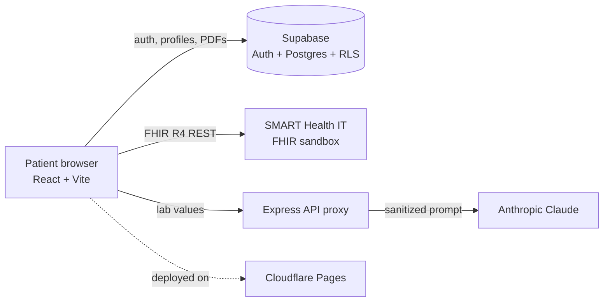

# AI-Powered Patient Portal

A patient-facing web app that pulls real health records over **SMART on FHIR R4** and uses an LLM to explain lab results in plain language, deliberately scoped as patient education, not diagnosis.

**Live demo:** [cs6440-group1.pages.dev](https://cs6440-group1.pages.dev/) · Georgia Tech CS 6440 (Introduction to Health Informatics), Spring 2026

> [!NOTE]
> The live demo's AI explanation feature is currently disabled. I rotated the API key after finding it exposed in the client bundle, and the fix (routing every Claude call through the server) is planned. Login, FHIR records, and lab results still work.

---

## What it does
- **Secure accounts:** registration and login with Supabase Auth, with each patient's profile protected by row-level security
- **Real FHIR data:** retrieves Patient, Observation (labs), and Condition resources from the SMART Health IT R4 sandbox, matched to the user through name-based patient lookup
- **Readable lab results:** values, dates, and color-coded High/Low/Normal flags
- **Plain-language explanations:** Claude explains each lab result in two or three friendly, non-alarming sentences
- **Document storage:** patients can upload and manage PDF reports

## Architecture



## Responsible AI and data handling
- **Education, not diagnosis:** the prompt limits the model to a short, non-alarming explanation and requires it to end by reminding the patient to consult their doctor
- **Input sanitization:** the API proxy strips markup and control characters from FHIR fields and caps their length before anything reaches the model
- **Least privilege:** row-level security means users can only read and write their own profile and documents
- **Synthetic data only:** the FHIR sandbox contains test patients, never real health information
- **Lesson learned:** the deployed build originally called Claude from the browser, which exposed the key. Model calls belong on the server, and the README note above tracks that fix.

## Tech stack
| Layer | Tools |
|---|---|
| Frontend | React, Vite, Material UI |
| Auth & data | Supabase (Auth, PostgreSQL, row-level security, storage) |
| Health data | HL7 FHIR R4, SMART Health IT sandbox |
| AI | Anthropic Claude API via an Express proxy |
| Deployment & monitoring | Cloudflare Pages, Sentry |

## My role (Zachary Wallace)
I led implementation and FHIR integration for a three-person team:
- Built the **FHIR data layer** (`useFhir`, `fhirUtils`): fetching, parsing, and normalizing Patient, Observation, and Condition resources
- Implemented **Supabase authentication** with FHIR patient-name verification and RLS-safe profile creation
- Integrated **Claude** for lab explanations and built the lab results UI
- Handled **deployment and monitoring:** Cloudflare configuration, the API proxy, and Sentry

**Team:** Carmen Lam (project topic, frontend, Supabase schema) · Meenal Kumar (initial app, technical design, AI chatbot) · Zachary Wallace (implementation, FHIR integration, deployment)

## Run it locally
```bash
npm install
npm run dev        # frontend at http://localhost:5173
node server/index.js   # API proxy
```

Create a `.env` in the project root:
```bash
VITE_SUPABASE_URL=your-supabase-project-url
VITE_SUPABASE_ANON_KEY=your-supabase-anon-key
# Server-side only. Never prefix secrets with VITE_, which ships them to the browser.
ANTHROPIC_API_KEY=your-anthropic-api-key
SUPABASE_URL=your-supabase-project-url
SUPABASE_SERVICE_KEY=your-supabase-service-key
```

<details>
<summary>Project structure</summary>

- `src/App.jsx`: routing and auth state
- `src/pages/`: Login, Register, PatientProfile, MedicalData, UploadReport
- `src/hooks/useFhir.js`: FHIR data fetching
- `src/utils/fhirUtils.js`: FHIR parsing and normalization
- `src/utils/auth.js`: authentication logic
- `src/utils/supabaseClient.js`: Supabase client
- `server/index.js`: Express proxy for Claude with input sanitization
</details>
